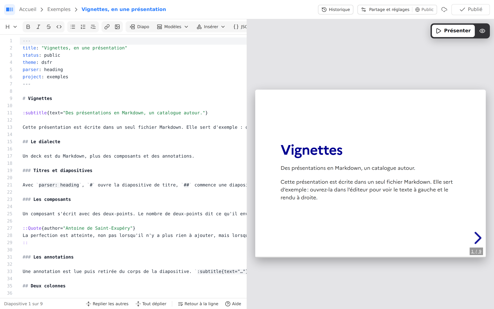
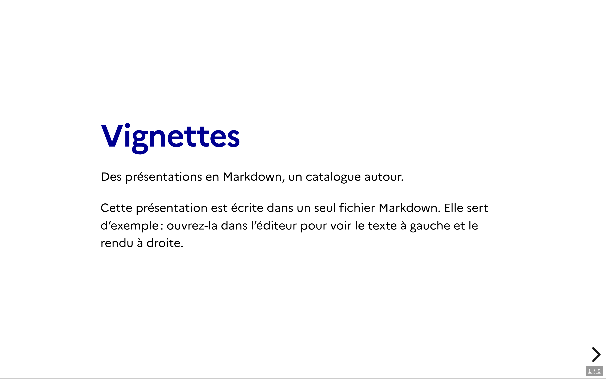

# Vignettes

A self-hosted catalog and editor for Markdown slide decks. Decks are written in MDC (Markdown with Vue components), rendered with reveal.js, edited collaboratively in the browser, and published as immutable versions with per-deck access rules.

The interface is available in French and English. The code, the packages and this documentation are in English.



## What it does

- **Catalog**: decks grouped in project folders, filtered by status and project, with a trash for reversible deletion.
- **Editor**: a CodeMirror editor with a live preview, real-time collaboration (Yjs over Hocuspocus), image paste and drop, and a draft that stays separate from what readers see.
- **Publishing**: publishing a draft creates a new immutable version; the catalog shows which decks have unpublished changes; `?draft` previews the draft on the deck page.
- **Access control**: four global roles (anonymous, viewer, editor, owner), three publication statuses (public, private, semi-private with a password) and an unlisted flag that keeps a deck out of the catalog, per-deck and per-project grants for collaborators, and pre-provisioned invitations by GitHub or Google handle.
- **Themes**: reveal.js themes compiled from SCSS on an engine package, with a DSFR base (the French state design system) that carries the palette and the typography and is made to be extended, a minimal theme, and a tenant's own brands shipped next to its decks; each deck picks its theme in its frontmatter.
- **Slide components**: columns, quotes, images with lightbox, media layouts, live Storybook embeds, Mermaid diagrams, JSON tours, speaker notes, fragments, and more.
- **Print**: any deck exports to PDF through reveal.js print mode.
- **Frozen bundles**: `mise run freeze -- <alias>` turns a deck into a self-contained static bundle with no server, database or JavaScript, served from object storage under the same access rules as the live deck, so a link stays alive long after the deck stops being maintained.

## Quick start

You need Node 22 and pnpm. [mise](https://mise.jdx.dev) installs both and runs the tasks.

```bash
git clone https://github.com/ShallowRed/vignettes.git
cd vignettes
mise install          # Node 22, pnpm, portless
mise run setup        # .env with a generated session secret, dependencies, database (PGlite in .data/pglite)
mise run dev:nuxt     # http://localhost:3000
```

Sign in with `/auth/dev-login?role=owner`, which answers in development only and needs no OAuth credentials. The catalog starts empty. Load the example deck with `node scripts/content-import.ts --content=examples --apply`, or open `/recette` and press Create to fill the catalog with nine decks covering every access situation, plus five personas you can browse the app as. Outside development that page needs `NUXT_RECETTE_ENABLED=1`, and an instance that sets it creates the data set at boot.

`mise run dev` runs the same server behind a local proxy on a `.localhost` host name, which lets several branches run at once. `dev:nuxt` needs no proxy.

Without mise, `pnpm install && pnpm dev` works once `.env` exists with a `NUXT_SESSION_PASSWORD` of at least 32 characters. Copy `.env.example` and fill that one line.

The database is PostgreSQL. Locally it runs inside the app through PGlite, in `.data/pglite`, and a single process opens that directory at a time: stop the development server before any task that opens it, such as `content:import`. A checkout whose decks are in `.data/slides.db` copies them with `mise run db:copy-sqlite`, or keeps SQLite with `NUXT_DATABASE_DRIVER=sqlite` in `.env`.

## Writing a deck

A deck is one Markdown file with a frontmatter block:

```markdown
---
title: My deck
theme: dsfr
parser: heading
---

# Title slide

## First section

Content.

### A vertical slide

More content.

::Quote{author="Someone"}
A quote.
::
```

Two parsers split the file into slides. With `parser: heading`, `#` opens the title slide, `##` starts a horizontal slide and `###` nests a vertical one under it. With `parser: separator`, which is what the shipped themes use unless a deck says otherwise, `---` separates horizontal slides and `----` vertical ones.

[examples/vignettes-demo.md](examples/vignettes-demo.md) is a deck that shows the dialect and loads into a running instance in one command. [docs/presentation-format.md](docs/presentation-format.md) says where a deck is stored and points at the reference of each package: the dialect and the generic components in [packages/nuxt](packages/nuxt/README.md), the explanation kit in [packages/schemas](packages/schemas/README.md), the story embeds in [packages/storybook](packages/storybook/README.md).



## Themes

A theme is a directory with a `theme.json` manifest and an SCSS entry, compiled to `public/themes/<name>.css`. Two packages carry the system:

| Package | What it is |
|---------|------------|
| [@vignettes/theme-kit](packages/theme-kit/README.md) | The engine layer: the semantic token contract, the Reveal patches, the slide skeleton, the media-layout grid, the scale presets |
| [@vignettes/theme-dsfr](packages/theme-dsfr/README.md) | The DSFR base theme: palette, Marianne typography, `layout` scale, made to be extended |

Both are pure SCSS with no dependencies, and are usable on any Reveal.js deck. [docs/theme-system.md](docs/theme-system.md) is the reference and has the tutorial.

## Content model

The database is the only runtime source of content. Each deck has a draft (a Yjs document), a list of published versions, and a pointer to the version readers see. `presentations/` holds the content space of an instance: deck stubs, brand themes and deck assets. Git ignores it; an instance that keeps its content in a repository clones it there, and the tasks below read it. A clone works without it.

| Task | Effect |
|------|--------|
| `mise run content:plan` | What an import would do, without writing |
| `mise run content:import` | Import the stubs the database does not own yet |
| `mise run content:republish -- <slug>` | New published version from the stub, access rules untouched |
| `mise run content:push -- <slug> --apply` | Same, on a deployed instance with its content token; `--content <dir>` reads another content directory, `--unlisted` keeps the deck out of the catalog |
| `mise run content:pull -- <slug> --apply` | The reverse: bring the published version of a deck from a deployed instance into the local database, for a deck that only exists there, before rebuilding its frozen bundle |
| `mise run theme:rename -- <from> <to> --apply` | Rename the theme the decks of a deployed instance declare, in every published version, draft and snapshot; `--deck <slug>` limits it to named decks |
| `mise run theme:push -- <name> --apply` | Publish a theme of the content space to the object storage the deployed instances serve it from |
| `mise run assets:push --apply` | Mirror `presentations/assets/` (images, backgrounds, pictograms referenced by decks) to the same object storage |
| `mise run freeze -- <alias>` | Build a deck's frozen bundle and upload it; `--storybook <dir>` embeds a built Storybook, `--no-upload` stops after the build |

## Access model

A request on a deck is decided by a pure function of the actor's role, the deck's status, the grants the actor holds, and the password cookie for semi-private decks. Owners and editors see everything; viewers see public decks plus what they were granted; anonymous readers see public decks. Owners manage accounts, roles, grants, and the trash. The full decision tree is in [docs/access-matrix.md](docs/access-matrix.md).

Sign-in uses GitHub or Google OAuth. Accounts are identified by provider and provider id; an owner can invite a handle before its first login so that grants apply immediately.

## Deployment

One instance serves one tenant.

The app builds into a Docker image (`Dockerfile`) that runs the Nitro server on port 3000. At start, `docker-entrypoint.sh` fetches the runtime secrets from Infisical with a machine identity and injects them into the process. With `NUXT_DATABASE_URL`, `run-app.sh` starts the app on that PostgreSQL server. Without it, the image runs SQLite on a volume: `run-app.sh` restores the database from object storage when the volume is empty and runs the app under Litestream replication. Set `INFISICAL_DISABLE=1` to give the container its environment directly instead. Without bucket credentials the app starts on the local database alone.

GitHub Actions builds the image on every push to `main` and `staging`, publishes it to GHCR, and deploys it over SSH to the matching environment. Docs-only commits do not trigger a build.

### Configuration

| Variable | Role |
|----------|------|
| `NUXT_SESSION_PASSWORD` | Session cookie secret, 32 characters minimum |
| `NUXT_OAUTH_GITHUB_CLIENT_ID`, `NUXT_OAUTH_GITHUB_CLIENT_SECRET` | GitHub sign-in |
| `NUXT_OAUTH_GOOGLE_CLIENT_ID`, `NUXT_OAUTH_GOOGLE_CLIENT_SECRET` | Google sign-in; the login page hides providers without credentials |
| `NUXT_OWNER_LOGINS`, `NUXT_EDITOR_LOGINS` | Handles that receive the owner and editor roles at login |
| `NUXT_DATABASE_URL` | PostgreSQL server, as a `postgres://` URL whose `sslmode` sets TLS. On Scalingo, `$SCALINGO_POSTGRESQL_URL` |
| `NUXT_PGLITE_DIR` | Without `NUXT_DATABASE_URL`: the PGlite directory, `.data/pglite` by default |
| `NUXT_DATABASE_DRIVER` | `sqlite`: the app runs on the SQLite file of `NUXT_DB_PATH` |
| `NUXT_DB_PATH` | SQLite file, `.data/slides.db` by default |
| `NUXT_CONTENT_DIR` | Content space: deck stubs and tenant themes, `presentations/` by default |
| `NUXT_CONTENT_TOKEN` | Bearer token that lets `content:republish:prod`, `content:push`, `content:pull` and `theme:rename` reach the instance without a session |
| `NUXT_FROZEN_S3_*` | Object storage for frozen bundles, uploaded media, and the database replica. The bucket name and the two keys are required together; without them the app serves `.frozen/`, `.media/` and `.themes/` from disk |
| `NUXT_RECETTE_ENABLED` | Exposes the demonstration and acceptance kit (`/recette`) outside development, and creates its data set and its five accounts at boot |
| `NUXT_PUBLIC_HELP_URL`, `NUXT_PUBLIC_FEEDBACK_URL` | Addresses of the « Documentation » and « Envoyer un retour » links, shown in the header and in the status bar of the editor, each hidden while empty |

`mise.local.toml`, which git ignores, holds the settings of one instance: `VIGNETTES_REMOTE`, the address of the deployed instance that `content:republish:prod`, `content:push`, `content:pull` and `theme:rename` talk to, and with `--staging`, `VIGNETTES_STAGING_REMOTE`, the address of the staging instance. These tasks take `NUXT_CONTENT_TOKEN` from Infisical, in the `prod` or `staging` environment.

`.env.example` lists them with comments. Locally, `.env` is read by Nuxt; in production the variables come from Infisical, or from the container's environment with `INFISICAL_DISABLE=1`.

## Development

```bash
mise run check        # lint, types and tests, what the CI checks
mise run test         # vitest: unit and golden tests
mise run test:e2e     # playwright: the production build renders a fixture deck
mise run lint         # eslint
mise run build        # themes, then Nuxt
```

Several branches can run at the same time, each in its own worktree with its own database and host name:

```bash
mise run worktree -- feat/my-branch      # ../vignettes.wt/feat-my-branch, ready to run
cd ../vignettes.wt/feat-my-branch && mise run dev
```

`packages/` holds the published units, from the deck core to the Nuxt render module and the themes. `layers/studio/` holds the application a tenant extends, with its own `src/`, `server/` and `shared/`. The root is one such tenant, with its themes in `themes/`, its content in `presentations/`, its tools in `scripts/` and its suites in `test/`. [docs/architecture.md](docs/architecture.md) describes the whole, [docs/api-routes.md](docs/api-routes.md) the HTTP API, and [docs/recette-staging.md](docs/recette-staging.md) the demonstration and acceptance kit.

## Contributing

[CONTRIBUTING.md](CONTRIBUTING.md) lists the checks and the conventions. [SECURITY.md](SECURITY.md) says how to report a vulnerability.

## License

MIT, see [LICENSE](LICENSE).
