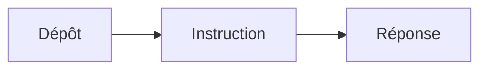

<!-- Generated by scripts/deck-plugin.ts: edit `examples/controle-du-theme.md`, then run `node scripts/deck-plugin.ts`. -->

# Control deck

Each slide role and each element a theme colors. Write the name of the theme under check in `theme:`; `theme-system.md`, section "Checking a theme", says what to read on each slide.

````md
---
title: Contrôle du thème
theme: exemple-marque
parser: heading
---

# Contrôle du thème

:subtitle{text="Chaque rôle de diapositive et chaque élément que colore un thème"}

## Une section

Une ligne avec [un lien](https://example.org) sur la surface de la section.

### Un contenu court

Une phrase sous le titre.

### Un contenu long

Un paragraphe avec un lien vers [la documentation](https://example.org), du texte **en gras** et du code en ligne : la commande `git diff --exit-code`, le chemin `docs/guides/getting-started.md` et la réponse `{"detail": "Resource not found."}`.

- Un élément de liste, assez long pour passer sur deux lignes quand la fenêtre est étroite.
- Un deuxième élément, avec `un segment de code`.
- Un troisième élément.

Un dernier paragraphe, en texte courant, pour remplir la hauteur de la diapositive et vérifier l'espace entre les blocs.

### Un tableau et une citation

| Étape | Délai |
|-------|-------|
| Dépôt | 1 jour |
| Instruction | 10 jours |

::Quote{author="Une usagère"}
La démarche tient sur une page.
::

### Un bloc de code

```ts
export function delai(jours: number): string {
  return `${jours} jours`
}
```

### Deux colonnes

:::Columns
::Column
La colonne de gauche, avec `du code en ligne`.
::

::Column
La colonne de droite.
::
:::

### Une image à droite

:layout{name="media-right" src="/images/placeholder.svg"}

Le texte occupe la partie gauche de la diapositive.

### Une image large à gauche

:layout{name="media-left-wide" src="/images/placeholder.svg" fit="contain"}

Le texte occupe la partie droite de la diapositive.

### Un diagramme Mermaid

::Mermaid

::

### Un diagramme dessiné

:::Diagram{layout="grid" cols="3"}
::Node{id="depot" at="1,1" picto="document/contract" title="Dépôt"}
::
::Node{id="instruction" at="2,1" picto="digital/data-visualization" title="Instruction"}
Une étape par agent
::
::Node{id="reponse" at="3,1" picto="digital/application" title="Réponse" :planned="true"}
::
::Edge{from="depot" to="instruction" label="transmet"}
::
::Edge{from="instruction" to="reponse" :dashed="true"}
::
:::

## Un titre `##` avec du contenu

Cette diapositive a un titre `##`, un paragraphe et un diagramme : elle prend le fond d'une diapositive de contenu.

::Mermaid

::
````
