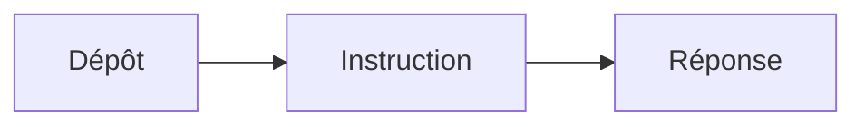

Un composant est un bloc nommé, qui met en forme une partie de la diapositive. Le nombre de deux-points dit ce qu'il contient :

- `::Nom` entoure du texte, jusqu'à la ligne `::` qui le ferme ;
- `:::Nom` contient d'autres composants, jusqu'à la ligne `:::` ;
- `:nom{…}` est un composant en ligne, dans une phrase.

On écrit les réglages d'un composant entre accolades : `::Quote{author="…"}`. Un réglage précédé de `:` reçoit une valeur JSON, comme `:fragments="false"`. Dans l'éditeur, le bouton « Aide » liste les composants et les insère dans le texte.

## Le texte

`Quote` affiche une citation et son auteur, `Highlight` un message mis en avant. `Fragments` fait apparaître les éléments d'une liste un par un, à chaque appui sur la flèche droite. `:i{name="…"}` insère une icône du jeu [Remix Icon](https://remixicon.com), dont le nom commence par `ri:`.

::deck-example
```mdc
### :i{name="ri:chat-quote-line"} Ce que disent les usagers

::Quote{author="Une usagère, entretien du 3 octobre"}
Je retrouve ma demande sans chercher.
::

---

### Les trois étapes

::Fragments
- La demande est déposée.
- Un agent l'instruit.
- L'usager reçoit la réponse.
::

::Highlight{variant="accent"}
Quinze jours en moyenne.
::
```
::

## Les colonnes

`Columns` place ses blocs `Column` côte à côte. `span` donne la largeur relative d'une colonne : `span="2"` à côté de `span="1"` partage la largeur en deux tiers et un tiers.

::deck-example
```mdc
### Ce qui change

:::Columns
::Column{span="2"}
#### Pour l'usager
Il suit sa demande en ligne et reçoit un message à chaque étape.
::

::Column{span="1"}
#### Pour l'agent
Il voit les pièces manquantes.
::
:::
```
::

## Les images et les pages web

`Image` affiche une image et sa légende, et `:preview="true"` l'agrandit au clic. `FullScreenImage` étend une image à toute la diapositive, et `Iframe` affiche une page web. Pour une image à côté du texte, utilisez une [mise en page](/ecrire/syntaxe#les-mises-en-page) `media-*`.

::deck-example
```mdc
### Le parcours

::Image{src="/images/placeholder.svg" alt="Des montagnes sous un soleil" width="60%" :preview="true"}
Les trois étapes du parcours.
::
```
::

Une image, une vidéo ou une page web doit être servie en `https://`. Une adresse en `http://` donne un cadre vide, sauf sur `localhost` pendant le développement.

## Les schémas

`Mermaid` dessine un diagramme décrit avec la syntaxe de [Mermaid](https://mermaid.js.org), dans un bloc de code `mermaid`.

::deck-example
````mdc
### Le parcours d'une demande

::Mermaid

::
````
::

`Scheme` aligne des étapes `Step` reliées par des flèches. Chaque étape a un numéro, un titre, une icône du jeu Remix Icon dans `icon` ou un [pictogramme du DSFR](/themes/theme-dsfr#les-pictogrammes) dans `picto`, et un texte. Elle apparaît à l'appui suivant sur la flèche droite ; avec `:fragments="false"`, toutes les étapes sont affichées dès l'arrivée sur la diapositive.

::deck-example
```mdc
### Le parcours d'une demande

:::Scheme{:fragments="false"}
::Step{n="1" icon="ri:file-add-line" title="Dépôt"}
L'usager remplit le formulaire.
::
::Step{n="2" icon="ri:loader-2-line" title="Instruction"}
Un agent vérifie les pièces.
::
::Step{n="3" icon="ri:mail-send-line" title="Réponse"}
L'usager reçoit un message.
::
:::
```
::

## Les notes de l'orateur

`Notes` contient vos notes pour une diapositive, en Markdown, à n'importe quel endroit de la diapositive. Vous les lisez dans la vue conférencier ([Présenter et exporter](/ecrire/presenter#la-vue-conférencier)) ; le public ne les voit pas, ni dans la présentation, ni dans le PDF.

```mdc
::Notes
- Le délai est compté du dépôt à la réponse.
- Rappeler que deux agents ont rejoint l'équipe en mars.
::
```

## Les stories Storybook

`StoryFrame` et `Screens` affichent des stories de votre Storybook : [Intégrer une story](/ecrire/story-storybook) les décrit.

## La liste complète

La référence de chaque paquet décrit tous ses composants et leurs réglages :

- [@vignettes/nuxt](/reference/nuxt) : le texte, les colonnes, les images, `Mermaid`, `Notes` et `Fragments` ;
- [@vignettes/schemas](/reference/schemas) : `Scheme`, `Diagram` et `JsonTour` ;
- [@vignettes/storybook](/reference/storybook) : `StoryFrame` et `Screens`.
