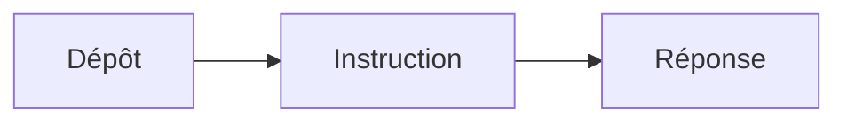

Un composant est un bloc nommé, qui met en forme une partie de la diapositive. Le nombre de deux-points dit ce qu'il contient :

- `::Nom` entoure du texte, jusqu'à la ligne `::` qui le ferme ;
- `:::Nom` contient d'autres composants, jusqu'à la ligne `:::` ;
- `:nom{…}` est un composant en ligne, dans une phrase.

On écrit les réglages d'un composant entre accolades : `::Quote{author="…"}`. On écrit un réglage vrai ou faux précédé de `:`, comme `:fragments="false"` ; sans les deux-points, la valeur est un texte. Dans l'éditeur, le bouton « Aide » liste les composants et les insère dans le texte.

Cette page présente les familles de composants et le cas où chacune sert. La [référence](#la-référence-des-composants) donne tous les réglages de chaque composant, avec leur valeur par défaut.

## Mettre une phrase en valeur

Une diapositive contient souvent une phrase que le public doit retenir : un verbatim d'usager, un chiffre, une conclusion. `Quote` présente une citation avec son auteur, et `Highlight` un message, seul ou dans un encadré. Dans un titre ou une phrase, `:i{name="…"}` ajoute une icône du jeu [Remix Icon](https://remixicon.com), dont le nom commence par `ri:`.

::deck-example
```mdc
### :i{name="ri:chat-quote-line"} Ce que disent les usagers

::Quote{author="Une usagère" role="Entretien du 3 octobre"}
Je retrouve ma demande sans chercher.
::

::Highlight{variant="accent"}
Quinze jours en moyenne, du dépôt à la réponse.
::
```
::

Réglages : [Quote](/reference/nuxt#quote), [Highlight](/reference/nuxt#highlight), [IconInline](/reference/nuxt#iconinline).

## Montrer les points un par un

Quand vous commentez une liste, le public lit plus vite que vous ne parlez. Dans `Fragments`, chaque élément de la liste apparaît à l'appui suivant sur la flèche droite, et le public suit le point dont vous parlez.

::deck-example
```mdc
### Les trois étapes

::Fragments
- La demande est déposée.
- Un agent l'instruit.
- L'usager reçoit la réponse.
::
```
::

Les schémas `Scheme`, `Diagram` et `JsonTour` de la section [Expliquer un système](#expliquer-un-système) apparaissent aussi étape par étape, et `Mermaid` avec son réglage `steps`. Réglages : [Fragments](/reference/nuxt#fragments).

## Comparer en colonnes

`Columns` place ses blocs `Column` côte à côte, pour comparer deux publics, deux options ou un avant et un après. `span` donne la largeur relative d'une colonne : `span="2"` à côté de `span="1"` partage la largeur en deux tiers et un tiers.

::deck-example
```mdc
### Ce qui change

:::Columns
::Column{span="2"}
#### Pour l'usager
Il suit sa demande en ligne et reçoit un message à chaque étape.
::

::Column{span="1"}
#### Pour l'agent
Il voit les pièces manquantes.
::
:::
```
::

Réglages : [Columns](/reference/nuxt#columns), [Column](/reference/nuxt#column).

## Montrer une image ou une page web

`Image` affiche une image et sa légende dans le texte de la diapositive, et `Iframe` affiche une page web. Pour une image ou une page à côté du texte, au-dessus, en dessous ou derrière lui, utilisez l'annotation `:layout`, décrite dans [Les mises en page](/ecrire/syntaxe#les-mises-en-page).

::deck-example
```mdc
### Le parcours

::Image{src="/images/placeholder.svg" alt="Des montagnes sous un soleil" width="60%" :preview="true"}
Les trois étapes du parcours.
::
```
::

Une image, une vidéo ou une page web doit être servie en `https://`. Une adresse en `http://` donne un cadre vide, sauf sur `localhost` pendant le développement.

Réglages : [Image](/reference/nuxt#image), [Iframe](/reference/nuxt#iframe).

## Expliquer un système

Quatre composants dessinent un schéma. Choisissez le composant selon ce que vous expliquez.

Pour un enchaînement d'étapes que vous racontez dans l'ordre, `Scheme` aligne des étapes `Step` reliées par des flèches. Chaque étape a un numéro, un titre, une icône dans `icon` ou un [pictogramme](/themes/theme-dsfr#les-pictogrammes) dans `picto`, et un texte. Elle apparaît à l'appui suivant sur la flèche droite ; avec `:fragments="false"`, toute la ligne est affichée dès l'arrivée sur la diapositive.

::deck-example
```mdc
### Le parcours d'une demande

:::Scheme{:fragments="false"}
::Step{n="1" icon="ri:file-add-line" title="Dépôt"}
L'usager remplit le formulaire.
::
::Step{n="2" icon="ri:loader-2-line" title="Instruction"}
Un agent vérifie les pièces.
::
::Step{n="3" icon="ri:mail-send-line" title="Réponse"}
L'usager reçoit un message.
::
:::
```
::

Pour les parties d'un système et ce qui circule entre elles, `Diagram` place des cartes `Node` sur une grille, à la case que donne `at="colonne,ligne"`, et les relie par des flèches `Edge`. Une zone `Area` regroupe les cartes d'une même machine ou d'une même équipe. `color` donne une teinte à une carte ou à une zone, par un nom de la palette du thème comme `green`, ou par une couleur CSS.

::deck-example
```mdc
### D'où viennent les données

:::Diagram{layout="grid" cols="3" :fragments="false"}
::Area{at="2,1" span="2,1" title="Le service" color="blue"}
::
::Node{id="src" at="1,1" icon="ri:file-list-3-line" title="Formulaire"}
::
::Node{id="api" at="2,1" icon="ri:server-line" title="API"}
::
::Node{id="base" at="3,1" icon="ri:database-2-line" title="Base" :planned="true"}
Prévue en mars
::
::Edge{from="src" to="api" label="envoie"}
::
::Edge{from="api" to="base" :dashed="true"}
::
:::
```
::

Pour un flux que vous décrivez en quelques lignes, sans régler la place de chaque élément, `Mermaid` dessine un diagramme écrit avec la syntaxe de [Mermaid](https://mermaid.js.org), dans un bloc de code `mermaid`.

::deck-example
````mdc
### Le parcours d'une demande

::Mermaid

::
````
::

Pour le contenu d'un fichier, partie par partie, `JsonTour` affiche le fichier à droite de la diapositive, et chaque zone `Zone` surligne les lignes qu'elle décrit, à l'appui suivant sur la flèche droite.

::deck-example
````mdc
### Le fichier d'une présentation

:::JsonTour{file="deck.json"}
::Zone{lines="2-3" title="Identité"}
Le nom et la version.
::
::Zone{lines="4" title="Contenu"}
Le nombre de diapositives.
::

```json
{
  "name": "bilan",
  "version": 3,
  "slides": 12
}
```

:::
````
::

Réglages : [Scheme](/reference/schemas#scheme), [Diagram](/reference/schemas#diagram), [JsonTour](/reference/schemas#jsontour), [Mermaid](/reference/nuxt#mermaid), et les [couleurs](/reference/schemas#colors).

## Préparer ce que vous direz

`Notes` contient vos notes pour une diapositive, en Markdown, à n'importe quel endroit de la diapositive. Vous les lisez dans la vue conférencier ([Présenter et exporter](/ecrire/presenter#la-vue-conférencier)).

```mdc
::Notes
- Le délai est compté du dépôt à la réponse.
- Rappeler que deux agents ont rejoint l'équipe en mars.
::
```

Réglages : [Notes](/reference/nuxt#notes).

## Montrer un écran de votre Storybook

`StoryFrame` et `Screens` affichent des stories de votre Storybook : [Intégrer une story](/ecrire/story-storybook) les décrit.

## La référence des composants

Chaque page de la référence donne, pour chaque composant, ses autres noms quand il en a, un exemple minimal, chacun de ses réglages avec son type, ses valeurs et sa valeur par défaut, et le contenu qu'il attend :

- [Module de rendu](/reference/nuxt#components) : `Quote`, `Highlight`, `Fragments`, `IconInline`, `Columns`, `Column`, `Image`, `Iframe`, `Mermaid` et `Notes` ;
- [Composants de schéma](/reference/schemas) : `Scheme`, `Step`, `Diagram`, `Node`, `Edge`, `Area`, `JsonTour`, `Zone` et leurs couleurs ;
- [Composants Storybook](/reference/storybook) : `StoryFrame` et `Screens`.
