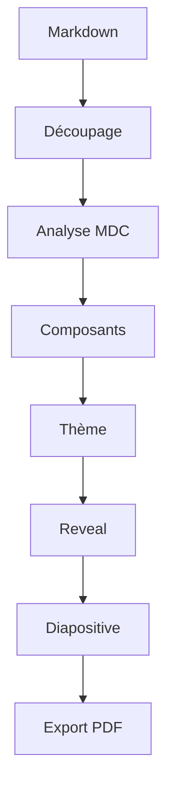

# Composants

:pretitle{text="Recette automatisée"}
:subtitle{text="Une diapositive par composant du contrat"}

Chaque diapositive exerce un composant ou une annotation du dialecte.

## Texte

### Citation

::Quote{author="Antoine de Saint-Exupéry" role="Écrivain"}
La perfection est atteinte lorsqu'il n'y a plus rien à retirer.
::

### Mise en avant

Une phrase où :highlight[un fragment porte l'accent] et une icône :i{name="ri:timer-flash-line"} dans la ligne.

### Colonnes

::TwoColumns
#### À gauche

- Première entrée

#### À droite

- Deuxième entrée
::

### Fragments

::Fragments{collapse}
- Premier point
- Deuxième point
::

### Notes

Le corps reste visible.

::Notes
Texte réservé à l'orateur.
::

## Médias

### Image

::Image{src="/images/placeholder.svg" alt="Image de substitution"}
Une légende
::

### Page intégrée

::Iframe{src="/images/placeholder.svg" height="300px"}
::

### Mermaid

::Mermaid

::

## Schémas

### Étapes

:::Scheme
::Step{n="1" picto="digital/coding" title="Un moteur"}
::
::Step{n="2" picto="digital/application" title="Une présentation"}
::
:::

### Diagramme

:::Diagram{layout="grid" cols="2" size="xs"}
::Area{at="1,1" span="2,1" title="Poste" color="blue-ecume"}
::
::Node{id="a" at="1,1" picto="digital/coding" title="Sources" color="blue-france"}
::
::Node{id="b" at="2,1" picto="digital/internet" title="Diffusion"}
::
::Edge{from="a" to="b" label="alimente"}
::
:::

### Séquence

:::Sequence{enter="first-row"}
::Actor{id="a" icon="ri:user-line" title="Autrice"}
::
::Actor{id="b" icon="ri:server-line" title="Serveur"}
::
::Actor{id="c" icon="ri:user-line" title="Lectrice"}
::
::Message{time="10 h 00" from="a" to="b" label="Publie"}
::
::State{label="État" values="a=Brouillon|b=Publié"}
::
::Remark{over="a,c"}
Rien ne prévient la lectrice.
::
:::

### Visite d'un fichier

:::JsonTour{file="deck.json" size="xs"}
::Zone{lines="2" picto="digital/coding" title="Identité"}
Un titre.
::

```json
{
  "title": "Composants"
}
```

:::

## Mises en page

### Média à droite

:layout{media="right" size="2/3" src="/images/placeholder.svg" type="image" fit="contain"}

Le texte occupe le tiers de gauche.

### Image derrière le texte

:layout{media="behind" src="/images/placeholder-dark.svg" alt="Image de démonstration" veil="40%"}

Le texte est en couleur claire sur un voile sombre.

### Cadres

:::Screens{cols="2"}
::StoryFrame{src="/images/placeholder.svg" type="image" label="Premier cadre"}
::
::StoryFrame{src="/images/placeholder.svg" type="image" label="Second cadre"}
::
:::

### Lien de bas de diapositive

:quicklink{text="Retour au catalogue" href="/"}

Le lien reste épinglé en bas.

## Fond

:slide-background{image="/images/placeholder.svg"}

### Pleine page

::FullScreenImage{src="/favicon.svg" alt="Fond de démonstration"}
::
