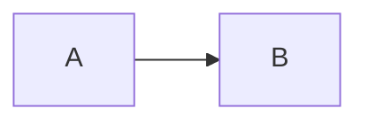

# Attributs vides

Chaque diapositive contient un composant dont un attribut est vide, absent ou sans valeur.

## Fragments sans effet

:::Fragments{effect=""}
- Premier point
- Deuxième point
:::

## Fragments avec deux effets

:::Fragments{effect="fade-up grow"}
- Premier point
- Deuxième point
:::

## Colonne sans largeur

::::Columns
::Column{ratio}
Colonne de gauche
::
::Column
Colonne de droite
::
::::

## Mermaid sans étapes

::Mermaid{steps}

::

## État sans valeurs

:::Sequence
::Actor{id="a" title="Usager"}
::
::Actor{id="b" title="Service"}
::
::Message{from="a" to="b" via label="Demande"}
::
::State{label="Brouillon"}
::
::Remark{over}
Une remarque sous les deux participants.
::
::State{label="Envoyé" values="a=Envoyé|b=Reçu" mark}
::
:::

## Diagramme automatique, nœud sans nom

:::Diagram{layout="auto"}
::Node{id="" title="Sans nom"}
::
::Node{id="a" title="Source"}
::
::Node{id="b" title="Destination"}
::
::Edge{from="a" to="b"}
::
::Edge{from="" to="a"}
::
:::

## Diagramme en grille, attributs sans valeur

:::Diagram{layout="grid" cols="2"}
::Area{at span title="Zone" icon}
::
::Node{id="a" at="1,1" span title="Source" icon}
::
::Node{id="b" at="2,1" title="Destination"}
::
::Edge{from="a" to="b" anchors}
::
:::

## Lecture de fichier, attributs sans valeur

::::JsonTour{file="exemple.json" mark underline}
::Zone{lines title="Identité" spot}
Ce que ces lignes contiennent.
::

```json
{
  "nom": "Exemple",
  "version": 1
}
```
::::
